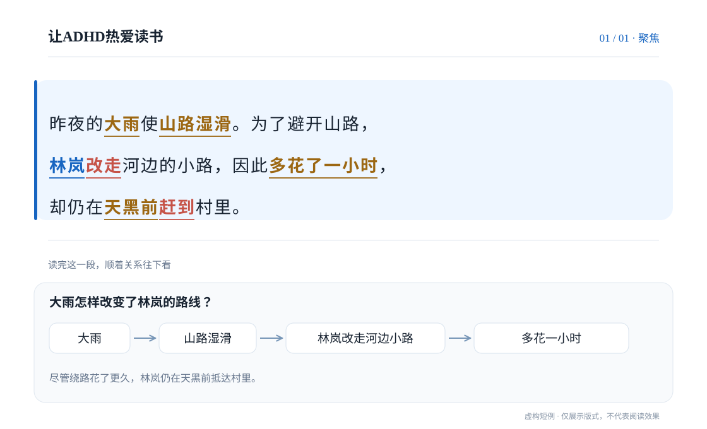
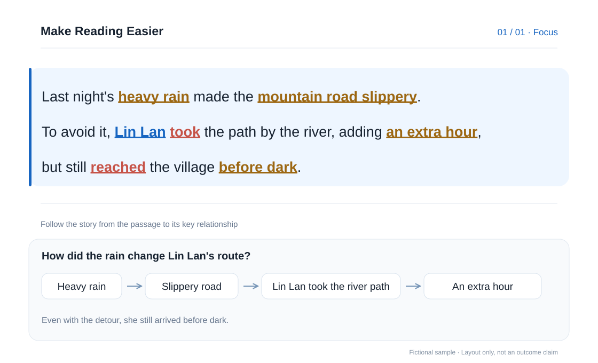

# 让ADHD热爱读书
### 读一段忘一段？帮你看清每段在说谁、发生了什么。
### Read a paragraph and lose track? See who it’s about and what happens.

[立即体验三篇试读 / Try the 3 reading samples](https://slow-reading-focus.may101hong.chatgpt.site/test) · [查看 Skill 文件 / View the Skill](SKILL.md)

---

## 目录 / Contents

[为什么做它 / Why it exists](#why-it-exists) · [使用案例 / Example](#example) · [阅读时会发生什么 / How it works](#how-it-works) · [立即试读 / Try it](#try-it) · [如何使用 / How to use](#how-to-use) · [文件说明 / Files](#files) · [使用边界 / Limitations](#limitations)

## 为什么做它 / Why it exists

读一篇长文时，可能刚读完一段，就忘了里面说的是谁、发生了什么，也不容易看出它和前后段落的关系。

**让ADHD热爱读书**面向 ADHD 读者，也适合任何读长文时容易丢线索的人。它保留完整原文，用颜色和下划线标出关键短词组，再用紧跟段落的小图梳理人物、行动和段落关系。

When reading a long passage, it’s easy to lose track of who did what—or how one paragraph connects to the next.

**Make Reading Easier** is designed for readers with ADHD and anyone who finds long texts hard to follow. It keeps the full original text, underlines a few meaningful phrases with color, and adds a small diagram next to the passage to show how people, actions, and ideas connect.

## 使用案例 / Example

**原文 / Original**

> 昨夜的大雨使山路湿滑。为了避开山路，林岚改走河边的小路，因此多花了一小时，却仍在天黑前赶到村里。

> Heavy rain made the mountain road slippery last night. To avoid it, Lin Lan took the path by the river, adding an hour to the trip, but still reached the village before dark.

**使用 Skill / With the Skill**

蓝色标人物或对象，珊瑚色标行动，琥珀色标重要处境。标记直接落在原文短词组上；关系图放在对应段落下方。

Blue marks people or things, coral marks actions, and amber marks important context. The phrases stay inside the original text, with a small relation map below the passage.

*以上是虚构短例，只展示版式，不代表阅读效果。 / These are fictional examples to show the layout, not evidence of reading outcomes.*

## 阅读时会发生什么 / How it works

1. **保留完整原文 / Keep the full text**  
   段落、编号、引文和顺序都会保留，不用摘要替代原文。  
   Paragraphs, numbering, quotes, and order stay intact. A summary never replaces the original.

2. **标出关键短词组 / Mark a few key phrases**  
   蓝色标人物、对象或概念；珊瑚色标行动或变化；琥珀色标重要处境或判断。颜色配合下划线，标记密度可以调整。  
   Blue marks people, things, or ideas; coral marks actions or changes; amber marks important context or judgments. Color is paired with an underline, and marking density can be adjusted.

3. **把关系图放在对应段落旁或下方 / Place a small map beside or below the passage**  
   只画原文支持的顺序、对照、分类或因果关系，不补写原文没有的信息。  
   Maps show only relationships supported by the text, such as sequence, contrast, categories, or cause and effect.

4. **按自己的节奏阅读 / Read at your own pace**  
   可以切回原文、连续阅读，也可以调整字号和标记密度。  
   Switch back to the original, read continuously, or adjust text size and marking density.

## 立即试读 / Try it

[打开三篇试读页面 / Open the three reading samples](https://slow-reading-focus.may101hong.chatgpt.site/test)。页面包含故事、知识和观点三类文章，点开即可阅读，无需答题或评分。

The samples include a story, an informational article, and an opinion piece. Open one and start reading—no quiz or rating is required.

## 如何使用 / How to use

把仓库中的 Skill 文件放进支持 Skill 的 AI 工具，然后输入：

Add the Skill from this repository to an AI tool that supports Skills, then prompt it:

~~~text
请用 $adhd-love-reading 处理这篇文章。
保留完整原文，用适中密度标出关键短词组；
把有依据的小图放在它解释的段落后。

Use $adhd-love-reading to format this passage for reading.
Keep the full original text, underline a moderate number of key phrases,
and place each evidence-based map below the passage it explains.
~~~

## 文件说明 / Files

| 文件 / File | 用途 / Purpose |
| --- | --- |
| [SKILL.md](SKILL.md) | 处理流程、阅读界面规则和检查项 / Workflow, reading layout, and quality checks |
| [agents/openai.yaml](agents/openai.yaml) | Skill 展示名称与默认提示 / Display name and default prompt |
| [assets/icon.svg](assets/icon.svg) | Skill 图标 / Skill icon |
| [assets/reading-case.svg](assets/reading-case.svg) | 中文视觉案例 / Chinese visual example |
| [assets/reading-case-en.svg](assets/reading-case-en.svg) | English visual example / 英文视觉案例 |

## 使用边界 / Limitations

这是阅读辅助工具，不是诊断或治疗工具；不承诺提升阅读速度、理解力或治疗 ADHD。涉及最新新闻、医学等需要核实的信息，应另行查证并标明来源。分享他人文章前，请确认有权公开；仓库公开可见不代表内容可自由复制、修改或再发布。

This is a reading aid, not a diagnostic or treatment tool. It does not promise to improve reading speed or comprehension, or to treat ADHD. Verify current news, medical, and other time-sensitive claims with reliable sources and cite them. Make sure you have permission before sharing someone else’s writing; public visibility does not grant permission to reuse or republish it.
